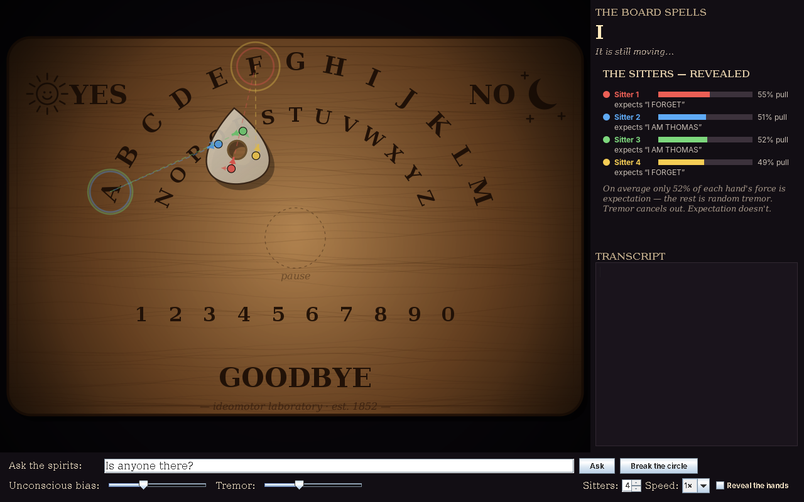

# 🕯️ Ouija Lab

**A talking board that spells out messages from beyond. Nobody is pushing it. Honest.**



Four sitters rest their fingers on the planchette. You ask a question. The planchette begins to stir… and slowly, letter by letter, it spells out an answer.

*UNDER THE STAIRS.*
*I DROWNED.*
*WE ARE MANY.*

Then it glides down to **GOODBYE**, and the spirit is gone.

Every sitter swears they didn't move it. And every one of them is telling the truth, as far as they know.

---

## 👻 What's really going on

Ouija Lab is a simulation of the **ideomotor effect**, named by the physiologist William Carpenter in 1852. It's the way expectation turns into tiny muscle movements you don't notice yourself making.

Each simulated hand does two things:

- **Trembles.** Random physiological jitter that points every which way.
- **Leans, ever so slightly,** toward whichever letter that sitter *expects* to come next.

At first the sitters disagree about what the spirit wants to say. But as letters appear, the guesses that no longer fit fall away. Sitters start following the planchette's lead and each other's. Soon they all expect the same thing. The tremor cancels out and the expectation adds up.

No ghost required. (Probably.)

## 🔮 Summoning

You'll need Java 11 or newer. No build step and no dependencies:

```
java OuijaLab.java
```

## 🖐️ At the table

| Control | What it does |
|---|---|
| **Ask the spirits** | Type a question and press Enter. "What is your name?", "Where are you?", "How did you die?", "Is anyone there?"… Leave it blank for an open séance. |
| **Break the circle** | End the séance early. The spirits won't like it. |
| **Unconscious bias** | How strongly expectation leaks into each hand. Turn it up and the answers come out clean. Turn it down and you get garbled near-misses. At zero there's no spirit at all, just random letters. |
| **Tremor** | How shaky the hands are. |
| **Sitters** | One to six people at the table. |
| **Reveal the hands** | 👁️ The moment of truth. Shows every sitter's pull (thick arrow), tremor (thin arrow), the letter they're secretly aiming for, and the message they *think* the spirit is spelling. |

Spirits sometimes misspell. Sitters usually forgive them: "MARZ" is obviously MARY.

## 🧪 Try this

1. Ask *"What is your name?"* and watch a name appear.
2. Ask again with **Reveal the hands** ticked. Watch four people quietly argue over THOMAS vs AGNES, then all fall into line.
3. Set **Unconscious bias** to zero and ask again. Now nothing is reaching the board except tremor.

## 📜 Credits

Concept: **Mario Gianota**. Implementation: **Claude** (Anthropic).
Conjured for Halloween 2026. MIT License.

*Don't forget to say goodbye.* 🕯️
